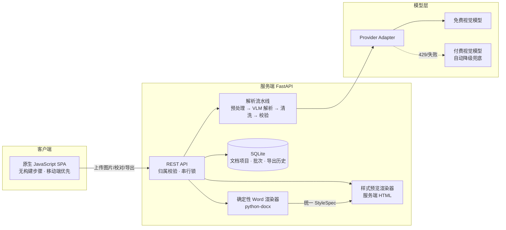

# 快速录题助手（Quick Question Entry）

> 手机批量拍照 → AI 结构化解析 → 人工校对 → 一键导出标准排版的 Word 试卷文档


**快速录题助手**解决一个真实痛点：纸质试卷/习题册上的题目，手工重新录入电脑费时费力。本项目把这件事压缩成一条流水线——用手机对试卷**批量拍照**（单次最多 20 张），视觉大模型把图片解析成**结构化题目 JSON**，经过**人工校对**后由**确定性渲染器**生成统一排版、可直接打印的 `.docx` 试卷文档；并且支持**文档续加**：随时打开同一份文档继续拍新的题目，已确认的题目编号、顺序、内容永不改变。

真实使用成本参考：22 道题分两批录入，模型调用总花费 **¥0.036**。

---

## 目录

- [核心特性](#核心特性)
- [系统架构](#系统架构)
- [关键技术设计](#关键技术设计)
- [技术栈](#技术栈)
- [快速开始](#快速开始)
- [Web 界面](#web-界面)
- [命令行用法](#命令行用法)
- [API 概览](#api-概览)
- [目录结构](#目录结构)
- [工程实践](#工程实践)

## 核心特性

- **批量拍照录入**：相册多选上传（≤20 张/批），兼容单张、截图、PDF（自动拆页）；多图并发解析，单图失败只隔离记录、不阻塞整批，支持单张重试
- **乱序免疫**：源图题号可能乱序、跳号、重号、缺失——全部视为正常输入，按版面位置与上传顺序智能排序，绝不按源题号数字排序
- **文档续加**：题目以「文档项目」持久化，新批次确认并入后追加到末尾，既有题目的身份（id）、位置（order）、内容零变化
- **题型覆盖**：单选/多选/判断/填空/简答等纯文字题型 + 规整矩形表格题（逐格提取）
- **样式系统**：内置多套排版预设（字号、行距、题号格式等），样式面板预览与导出 docx 出自**同一份样式定义**，所见即所得
- **成本可控**：模型链自动降级（免费模型优先、付费模型兜底），单张图解析成本上限硬约束，内置离线演示模式（不调任何模型，0 成本跑通全链路）

## 系统架构



设计上的关键取舍：**模型绝不直接生成 Word 内容**。视觉大模型只负责把图片转成结构化 JSON，所有排版由确定性渲染器根据 StyleSpec 完成——模型幻觉最多影响文字内容（可人工校对），永远不会破坏文档格式。

## 关键技术设计

### 1. 顺序与编号体系（本系统最容易做错的地方）

试卷图片的现实情况：题号乱序（同一页上 25/16/27）、跨页跳号、多卷重号。本系统将三个概念严格分离：

| 概念 | 含义 | 生命周期 |
|------|------|----------|
| `id` | 题目身份 | 跨批次永不改变，编辑/续加均不影响 |
| `order` | 列表位置 | 导出编号的唯一依据，按位置重排（`renormalize`） |
| `source_label` | 源图题号 | 仅溯源自校准页，导出件不显示 |

排序采用**四级键** `(upload_order, page_index, column, bbox_y)`：先按用户点选图片的顺序，再按页内位置，并支持**双栏试卷**（先左栏后右栏）。批次内部只在边界处排序一次，之后列表顺序就是唯一真相——新批次题目一律追加到末尾，既有题目原位不动。

### 2. 模型与排版解耦：结构化 JSON 是唯一交接面

```
图片 → VLM（提示词约束 + JSON Schema 校验 + 失败自动修复）→ 题目 JSON
                                                          ↓
StyleSpec ─→ 确定性渲染器 ─→ .docx（python-docx）
        └──→ 服务端 HTML 预览（与 docx 同一份样式定义）
```

- 解析契约 `PageParse` 刻意**不含** id/order 等位置字段——并发解析结果按上传顺序归位，禁止按模型返回顺序或完成顺序拼接
- 模型输出先经**确定性清洗**（全半角、空白、标点归一）再校验，每处改动记录 warning，人工校对时有迹可循
- JSON 解析失败自动进入**修复重试**通道，而非直接丢弃

### 3. Provider 抽象与模型链降级

所有模型调用经 Provider Adapter 收口，切换供应商只改一个环境变量。生产采用**模型链**：免费视觉模型优先（限流时自动降级到付费模型兜底），配合并发上限与单页超时，把单张图解析成本钉死在预算内。

### 4. 草稿批次与串行写入

未确认的解析结果是**草稿**，确认并入才写入文档项目；文档项目级写入加**串行锁**，并发续加不会相互覆盖。删除走**软删除 + 回收站**，复制文档时逐题重生成 id 防止两份文档共享身份。

### 5. 三层端到端质量门禁

| 层 | 工具 | 防什么 |
|----|------|--------|
| 语法门禁 | pytest 内嵌 `node --input-type=module --check` | `node --check` 对 ES 模块走 CommonJS 宽松解析，浏览器会炸而检查全绿的假阳性 |
| API 验收 | httpx 脚本 8 步全链路 | 建文档→上传→解析→校对→并入→导出接口级回归 |
| UI 验收 | Playwright（真 Chromium/Edge，390×844 移动视口） | 真浏览器渲染 + 断言全程零控制台错误 + 导出文件真实下载 |

### 6. 部署可靠性细节

- **内容指纹版本化静态资源**：静态目录 sha256 指纹注入资源 URL，内容一变 URL 即变——旧缓存（哪怕是损坏的）永远不会被再次命中
- **SPA 回退用 307 重定向**回根路径并保留查询串，避免深路径下相对资源错位
- **前端依赖全部同源自托管**，不依赖公共 CDN——网关/CDN 的 HTML 错误页被浏览器当 JS 解析会报出误导性的 SyntaxError

## 技术栈

| 层 | 选型 | 说明 |
|----|------|------|
| 后端 | Python 3.11+ / FastAPI / Pydantic v2 | 显式 Stage 流水线，不用重型编排框架 |
| 存储 | SQLite | 文档项目 + 串行锁，单机即开即用 |
| 渲染 | python-docx | 中文 eastAsia 字体、表格、题号样式全覆盖 |
| 前端 | 原生 ES Module SPA | 零构建、零依赖，FastAPI 同源托管 |
| 模型 | 智谱 GLM 视觉模型 / 通义 Qwen-VL | Provider Adapter 可插拔 |
| 质量 | pytest(326) + ruff + Playwright | 三层门禁见上 |

## 快速开始

```bash
# 1. 安装（Python 3.11+）
pip install -r requirements.txt

# 2.（可选）配置真实模型：项目根目录建 .env
#    QQE_PROVIDER=glm
#    GLM_API_KEY=你的密钥
#    不配置则默认离线演示模式，全链路可跑通、0 成本

# 3. 启动 Web 服务（演示模式）
python -m qqe serve --fake
# 浏览器打开 http://127.0.0.1:8000

# 4. 或使用命令行直接解析
python -m qqe run 试卷1.jpg 试卷2.jpg -o out.docx --fake
```

> `--fake` 为离线演示模式：不调用任何模型，用内置样例数据返回固定解析结果，适合体验交互与排版效果。

常用环境变量：

| 变量 | 默认 | 说明 |
|------|------|------|
| `QQE_PROVIDER` | `fake` | 模型提供方（`fake` / `glm` / `qwen`） |
| `GLM_API_KEY` | 无 | 智谱 API Key |
| `GLM_MODELS` | 免费优先+付费兜底 | 逗号分隔的模型链，按序降级 |
| `QQE_MAX_CONCURRENCY` | `4` | 单批并发解析张数 |

## Web 界面

移动端优先的单页应用，核心流程四步：

1. **文档列表**：新建/重命名/复制/删除文档，回收站可恢复
2. **上传解析**：相册多选 → 实时进度 → 失败图片单张重试
3. **人工校对**：题卡逐题编辑（题型/题干/选项/表格）、拖拽调序、拆分与合并、残题恢复、对照原图
4. **导出**：样式预设实时预览 → 全量/仅新增导出 → 历史记录可重复下载

## 命令行用法

```bash
python -m qqe run <图片或目录...> -o out.docx [选项]

  --style <预设>      排版预设
  --project p.json    传入已存在文件即为「续加」，老题零变化
  --review            导出前打印解析结果供确认
  --concurrency 4     并发解析张数
  --fake              离线演示，不调用模型
```

## API 概览

| 方法 | 路径 | 说明 |
|------|------|------|
| `POST` | `/api/projects` | 新建文档项目 |
| `POST` | `/api/projects/{id}/uploads` | 上传图片（≤20 张/批） |
| `POST` | `/api/projects/{id}/batches` | 发起解析批次（202 异步任务） |
| `GET` | `/api/batches/{id}` | 轮询批次进度与解析草稿 |
| `PATCH` | `/api/batches/{id}/questions/{qid}` | 校对修改单题 |
| `POST` | `/api/batches/{id}/confirm` | 确认并入文档（老题零变化） |
| `POST` | `/api/projects/{id}/exports` | 生成导出（docx） |
| `GET` | `/api/exports/{id}/download` | 下载导出文件 |

## 目录结构

```
src/qqe/
├── domain/        # 领域模型：Question/Project/StyleSpec/排序与合并
├── preprocess/    # 图片加载、规范化（PDF 拆页、方向纠正）
├── parser/        # VLM 提示词、JSON 修复、表格提取、批次并发
├── validators/    # 确定性清洗 + 结构校验（先清洗再校验）
├── providers/     # Provider Adapter：GLM/Qwen/演示实现 + 成本计算
├── orchestrator/  # 流水线编排与状态机
├── project/       # 文档项目服务：续加/复制/软删除
├── store/         # SQLite 持久化 + 项目级串行锁
├── renderer/      # 确定性 Word 渲染器（段落/表格/字体/角色样式）
├── preview/       # 服务端 HTML 样式预览（与 docx 同一 StyleSpec）
├── api/           # FastAPI 路由/Schema/任务管理/静态资源版本化
└── web 托管       # 前端 SPA 同源托管（web/ 目录）
web/               # 原生 JavaScript SPA（无构建步骤）
```

## 工程实践

- **326 个 pytest 用例**全绿 + ruff 静态检查（规则集显式固定，杜绝升级漂移）
- 领域逻辑（排序、合并、编号）与 I/O 严格分层，核心纯函数可独立测试
- 每个里程碑以「端到端验收脚本」收口：后端 API 8 步 → Playwright 真浏览器 UI 8 步 → 线上冒烟
- 真实数据验收记录：11 题 + 续加 11 题，`order` 1~22 连续，老题 id/内容/顺序零变化

## License

[MIT](LICENSE)
