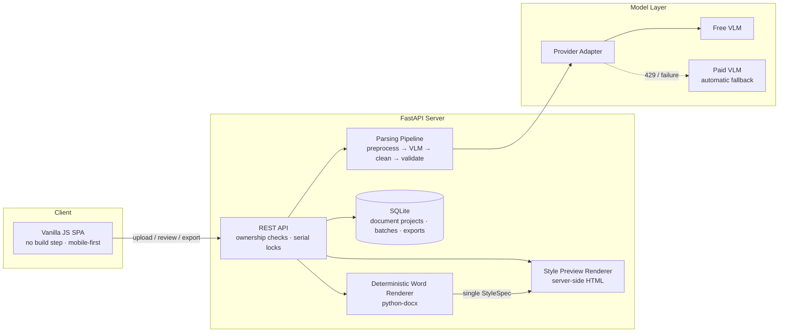

# Quick Question Entry (快速录题助手)

> Batch photo capture → AI-powered structured parsing → human review → one-click export of print-ready Word documents


**Quick Question Entry** solves a real-world pain point: retyping exam questions from paper into a computer is slow and error-prone. This project turns it into a pipeline — take **batch photos** of a test paper with your phone (up to 20 per batch), let a vision-language model parse them into **structured question JSON**, review and correct the results in a web UI, then export a consistently formatted, print-ready `.docx` exam document. Documents support **incremental append**: reopen the same document anytime, shoot new questions, and every previously confirmed question keeps its identity, position, and content untouched.

Real-world cost reference: 22 questions across two batches, total model cost **≈ ¥0.036 (under $0.01)**.

[中文文档](README.md)

---

- [Features](#features)
- [Architecture](#architecture)
- [Key Design Decisions](#key-design-decisions)
- [Tech Stack](#tech-stack)
- [Quick Start](#quick-start)
- [Web UI](#web-ui)
- [CLI Usage](#cli-usage)
- [API Overview](#api-overview)
- [Project Layout](#project-layout)
- [Engineering Practices](#engineering-practices)

## Features

- **Batch photo intake**: multi-select from phone gallery (≤20 per batch); also accepts single images, screenshots, and PDFs (auto page-splitting). Concurrent parsing with per-image failure isolation — one bad image never blocks the batch, and any image can be retried individually.
- **Immune to out-of-order numbering**: source question numbers may be shuffled, skipped, duplicated, or missing — all treated as normal input. Ordering is derived from layout position and upload order, never from the printed numbers.
- **Incremental documents**: questions persist in a "document project". Newly confirmed batches append to the end; existing questions keep their id, position, and content with zero drift.
- **Question coverage**: text-only types (single/multiple choice, true/false, fill-in-the-blank, short answer) plus well-formed rectangular tables (cell-by-cell extraction).
- **Style system**: multiple built-in layout presets (font size, line spacing, numbering format). The style preview and the exported `.docx` are generated from **one shared style definition** — true WYSIWYG.
- **Cost control**: model chain with automatic fallback (free model first, paid fallback), hard per-image cost budget, plus a built-in offline demo mode that runs the entire pipeline with zero model calls.

## Architecture



The key architectural choice: **the model never generates Word content directly**. The vision model only converts images into structured JSON; all layout is produced by a deterministic renderer driven by a StyleSpec. Model hallucinations can at worst affect text content (fixable in review) — never the document format.

## Key Design Decisions

### 1. Ordering & numbering system (the easiest part to get wrong)

Real exam photos contain shuffled numbers (25/16/27 on one page), gaps across pages, and duplicates across papers. The system separates three concepts:

| Concept | Meaning | Lifetime |
|---------|---------|----------|
| `id` | question identity | never changes across batches or edits |
| `order` | position in the list | sole basis for export numbering; rewritten by position (`renormalize`) |
| `source_label` | printed number in the photo | provenance only; never shown in exports |

Ordering uses a **four-level key** `(upload_order, page_index, column, bbox_y)`: user-selected image order first, then on-page position, with support for **two-column layouts** (left column before right). Sorting happens once at batch boundaries only; afterwards the list order is the single source of truth — new batches always append, existing questions never move.

### 2. Model ↔ layout decoupling: structured JSON as the only contract

```
Image → VLM (prompt constraints + JSON Schema validation + auto-repair) → question JSON
                                                                        ↓
StyleSpec → deterministic renderer → .docx (python-docx)
        └─→ server-side HTML preview (same style definition as the docx)
```

- The parsing contract `PageParse` deliberately **excludes** positional fields (id/order) — concurrent results are placed by upload order, never by model return order or completion order.
- Model output passes through **deterministic cleaning** (full/half-width, whitespace, punctuation normalization) before validation; every modification is logged as a warning so reviewers can trace changes.
- Failed JSON parses enter an **auto-repair retry** path instead of being dropped.

### 3. Provider abstraction & model-chain fallback

All model calls funnel through a Provider Adapter; switching vendors is a one-line environment change. Production uses a **model chain**: the free vision model first (auto-fallback to a paid model on rate limits), combined with concurrency caps and per-page timeouts to pin per-image cost within budget.

### 4. Draft batches & serialized writes

Unconfirmed parse results are **drafts**; they only enter the document project upon confirmation. Project-level writes take a **serial lock**, so concurrent appends cannot clobber each other. Deletion is **soft-delete + trash**, and duplicating a document regenerates every question id to prevent two documents from sharing identity.

### 5. Three-layer end-to-end quality gates

| Layer | Tool | Catches |
|-------|------|---------|
| Syntax gate | pytest-embedded `node --input-type=module --check` | `node --check` falls back to lenient CommonJS parsing for ES modules — code that passes locally but throws `SyntaxError` in browsers |
| API acceptance | 8-step httpx end-to-end script | full-chain regression: create → upload → parse → review → confirm → export |
| UI acceptance | Playwright (real Chromium/Edge, 390×844 mobile viewport) | real browser rendering + assertion of **zero console errors** + real file download |

### 6. Deployment reliability details

- **Content-fingerprinted static assets**: a sha256 fingerprint of the static directory is injected into asset URLs — the URL changes whenever content changes, so stale caches (even corrupted ones) can never be hit again.
- **SPA fallback via 307 redirect** back to root with query strings preserved, preventing relative-asset path breakage on deep links.
- **All frontend dependencies self-hosted**, no public CDNs — gateway/CDN HTML error pages parsed as JavaScript produce misleading SyntaxErrors.

## Tech Stack

| Layer | Choice | Notes |
|-------|--------|-------|
| Backend | Python 3.11+ / FastAPI / Pydantic v2 | explicit-stage pipeline, no heavyweight orchestration frameworks |
| Storage | SQLite | document projects + serial locks; zero-config, single binary |
| Rendering | python-docx | full coverage of CJK `eastAsia` fonts, tables, numbering styles |
| Frontend | Vanilla ES-module SPA | zero build, zero dependencies, same-origin hosting by FastAPI |
| Models | Zhipu GLM vision / Alibaba Qwen-VL | pluggable via Provider Adapter |
| Quality | pytest (326) + ruff + Playwright | three-layer gates as above |

## Quick Start

```bash
# 1. Install (Python 3.11+)
pip install -r requirements.txt

# 2. (Optional) configure a real model — create a .env file in the project root:
#    QQE_PROVIDER=glm
#    GLM_API_KEY=your-api-key
#    Without configuration the app defaults to offline demo mode:
#    the full pipeline runs end-to-end at zero cost.

# 3. Start the web server (demo mode)
python -m qqe serve --fake
# Open http://127.0.0.1:8000

# 4. Or parse directly from the command line
python -m qqe run paper1.jpg paper2.jpg -o out.docx --fake
```

> `--fake` is the offline demo mode: no model calls, built-in sample data with fixed parse results — ideal for trying the interaction and layout.

Environment variables:

| Variable | Default | Description |
|----------|---------|-------------|
| `QQE_PROVIDER` | `fake` | model provider (`fake` / `glm` / `qwen`) |
| `GLM_API_KEY` | — | Zhipu API key |
| `GLM_MODELS` | free-first + paid fallback | comma-separated model chain, fallback in order |
| `QQE_MAX_CONCURRENCY` | `4` | concurrent pages per batch |

## Web UI

A mobile-first single-page application built around a four-step flow:

1. **Documents**: create / rename / duplicate / delete, with a recoverable trash bin
2. **Upload & parse**: multi-select from gallery → live progress → per-image retry on failure
3. **Human review**: per-question editing (type / stem / options / table), drag-to-reorder, split & merge, fragment recovery, side-by-side source image
4. **Export**: live style preview → full or incremental export → re-download from export history

## CLI Usage

```bash
python -m qqe run <images-or-dir...> -o out.docx [options]

  --style <preset>    layout preset
  --project p.json    pass an existing file to "append"; existing questions stay untouched
  --review            print parsed results for confirmation before export
  --concurrency 4     concurrent parsing
  --fake              offline demo, no model calls
```

## API Overview

| Method | Path | Description |
|--------|------|-------------|
| `POST` | `/api/projects` | create a document project |
| `POST` | `/api/projects/{id}/uploads` | upload images (≤20 per batch) |
| `POST` | `/api/projects/{id}/batches` | start a parse batch (202 async job) |
| `GET` | `/api/batches/{id}` | poll batch progress & parse drafts |
| `PATCH` | `/api/batches/{id}/questions/{qid}` | edit a single question during review |
| `POST` | `/api/batches/{id}/confirm` | confirm into the document (zero drift) |
| `POST` | `/api/projects/{id}/exports` | generate a docx export |
| `GET` | `/api/exports/{id}/download` | download the exported file |

## Project Layout

```
src/qqe/
├── domain/        # domain models: Question/Project/StyleSpec, ordering & merging
├── preprocess/    # image loading, normalization (PDF splitting, orientation)
├── parser/        # VLM prompts, JSON repair, table extraction, batch concurrency
├── validators/    # deterministic cleaning + structural validation (clean first)
├── providers/     # Provider Adapter: GLM/Qwen/demo + cost accounting
├── orchestrator/  # pipeline orchestration & state machine
├── project/       # document project service: append / duplicate / soft-delete
├── store/         # SQLite persistence + project-level serial locks
├── renderer/      # deterministic Word renderer (paragraphs/tables/fonts/roles)
├── preview/       # server-side HTML style preview (same StyleSpec as docx)
├── api/           # FastAPI routes/schemas/job manager/versioned static assets
└── web hosting    # same-origin SPA hosting (web/ directory)
web/               # vanilla JavaScript SPA (no build step)
```

## Engineering Practices

- **326 pytest cases** green + ruff static checks (rule set pinned explicitly to prevent version drift)
- Domain logic (ordering, merging, numbering) strictly separated from I/O; core pure functions are independently testable
- Every milestone closes with end-to-end acceptance: backend API 8 steps → Playwright browser UI 8 steps → live-site smoke test
- Real-data acceptance record: 11 questions + an appended batch of 11, `order` continuous 1–22, existing question ids/content/order unchanged

## License

[MIT](LICENSE)
